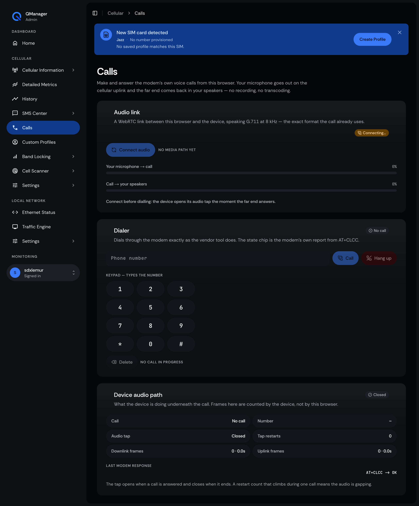
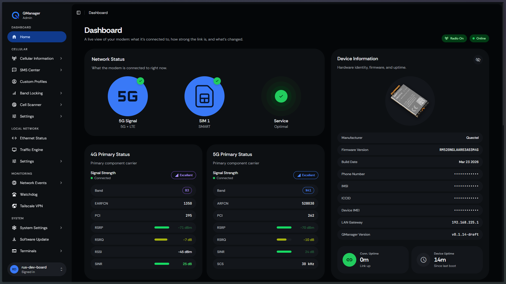
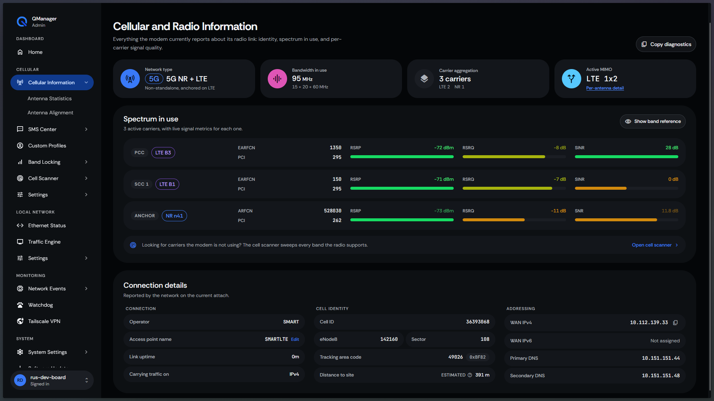

# ZLT X16 field tooling

Everything needed to take a stock **ZLT X16** 5G ODU (Qualcomm SDX65 +
SIMCom SIM8260E, ARMv7, one core) from vendor firmware to a working, observable,
self-healing stack — driven by the QManager UI, with the vendor's own
AT channel kept honest instead of guessed at.

> **Read [Safety and legal](#safety-and-legal) before running anything.** This
> tooling changes firmware state on a device. It is written for equipment you own
> or are authorised to administer.

```
ssh zlt-root 'uname -a'                  # 5.4.210 armv7l, 1 core
./deploy.sh                              # everything, in the right order
./deploy.sh --check                      # verify, change nothing
```

---

## What this is

The X16 ships a locked-down vendor image: a web UI on :80, a dialer that owns the
cellular data call, and **one serialised AT channel** (`atcmd_daemon` behind
`/bin/atcmd`) that everything modem-facing shares. There is no package manager, no
persistent journald, and the writable `/etc` volume mounts *after* systemd has
loaded its units — which is why half of this repository is about boot ordering.

This repo contains the analysis of that system and a set of self-contained
**modules** that fix it:

- **Observe it** — per-chain signal, CA state, WAN outage durations, a process page.
- **Keep it up** — IPACM (hardware offload) supervision, QManager unit healing, an
  AT-daemon guard for a vendor bug that silently kills call/SMS/USSD indications.
- **Use it** — browser call terminal with two-way VoLTE audio, SmartDNS, the AT
  dialect shim that lets a Quectel-speaking UI drive a SIMCom modem.
- **Understand it** — decompiled vendor binaries, and the measurements that decide
  what is safe to touch ([`docs/`](docs/README.md) is the index).

Nothing here is speculative: every page below was captured from a real unit, and
every fix carries the measurement that justified it.

## What you get

**Call terminal** — two-way VoLTE audio in the browser, G.711/WebRTC, with the
device's own audio-path counters visible so a gap is diagnosable:



**Dashboard and radio detail** — the QManager UI, backed by the SIMCom modem through
the AT shim (upstream capture, device identity redacted):



**Cellular radio information** — band, EARFCN, PCI, per-carrier status:



More captures, including the dialer popup and the calls log/recordings pages, live in
[`docs/captures/`](docs/captures/). To render the UI yourself against captured data,
without a device in the loop: [`scripts/demo/`](scripts/demo/).

## Step 0 — unlock the device first

This tooling assumes you already have a root shell on the unit. On a stock X16 the
vendor firmware gives you SSH but not root, so the unlock comes first, from the
companion repository:

**[zlt-x16-toolkit](https://github.com/RafayGhafoor/zlt-x16-toolkit)** — prebuilt
binaries for Windows, macOS and Linux (x86-64, arm64, armv7), no toolchain needed:

```sh
zltx16 probe  -host 192.168.3.1            # is it there, what is it
zltx16 verify -host 192.168.3.1 --ports 23,22   # is a shell already open
zltx16 unlock -host 192.168.3.1 -user <u> -pass <p> --confirm
```

Then come back here and deploy. **Order matters: unlock → deploy.**

## Quick start

Requirements on your machine: `ssh` (nothing else — no scp, no rsync, no python).
On the device: root shell access, from step 0.

```sh
git clone https://github.com/RafayGhafoor/zlt-x16-field-tooling.git
cd zlt-x16-field-tooling

./deploy.sh --list          # the modules, in deployment order, and why
./deploy.sh --dry-run       # the plan, and the exact command per module
./deploy.sh                 # deploy + verify, stopping at the first failure
```

Then reboot once — several of the fixes only prove themselves during boot ordering:

```sh
ssh zlt-root 'sync; reboot'     # ~90 s to come back
./deploy.sh --check
```

Anything individual module can be run, checked or rolled back on its own:

```sh
cd router-fix/atcmd-guard && ./install.sh            # deploy
cd router-fix/atcmd-guard && ./install.sh --check    # verify only
cd router-fix/atcmd-guard && ./install.sh --uninstall
```

## What each module does

| Module | What it fixes | Evidence it writes |
|---|---|---|
| `router-fix/ipacm/` | IPACM dies at boot → IPA gets zero rules and all forwarding falls back to software. Deploys a detached supervisor from `/etc/initscripts/start_cfgd`. | `/data/log/zlt-ipacm-boot.log`, `/sys/kernel/debug/ipa/stats` |
| `router-fix/atcmd-guard/` | The vendor's indication thread reopens a device node that does not exist and spins forever — AT keeps answering while call/SMS/USSD indications are dead. | `/data/log/zlt-atcmd-guard.log` (silent when healthy) |
| `router-fix/ttl-normalise/` | Tethered traffic leaves with TTL 63, a hotspot signature carriers act on. Sets 65, matching the reference CPE. | `iptables -t mangle -C …` |
| `router-fix/cpu-governor/` | Vendor `ondemand` on a one-core box; pins `performance` (~4 % on a fixed loop, measured). | `scaling_governor` |
| `router-fix/wan-recovery/` | Read-only outage recorder — how long each WAN drop actually lasts, parsed from the dialer's own stamps. | `/data/zlt-wan-recovery.log` |
| `router-fix/gnss-off/` | The GNSS daemon holds 16 threads and never gets a fix on this unit; stopped, masked and re-stopped at boot. | `/data/log/zlt-gnss-off.log` |
| `deploy-x16/` | The QManager UI itself, the AT dialect shim (Quectel ⇄ SIMCom), the path fix, the unit healer. | `http://<device>:8080/` |
| `deploy-x16/smartdns/` | Resolver + dnsmasq wiring + a 1-minute guard that re-applies it if anything clears it. | `/data/log/zlt-smartdns.log` |
| `router-fix/voip-bridge/` | The call terminal: PCM tap, WebRTC/G.711 bridge, QManager HTTPS front. | `/data/webrtc/log/calls.jsonl` |

Host-side tools that need no device state change:

| Tool | Use |
|---|---|
| `scripts/qmi-probe/` | Read-only QMI over QRTR with no libqmi — 12.5 ms/call, takes no AT lock |
| `scripts/at-probe/` | Module serial number, modem reboot policy, NV by number or EFS path, daemon/bus health |
| `scripts/flap-meter/` | 1 Hz typed radio transitions, joined against the dialer log to say what precedes a drop |
| `scripts/modem-profile/` | Capability vs policy vs actual, plus churn rate |
| `scripts/efs-nv/` | Modem EFS/NV access and verified backups (armv7 build) |
| `scripts/decompile/` | Vendor ARM ELF → annotated C |
| `scripts/gnss-probe/` | Does this unit get a GNSS fix (it needs sky) |
| `scripts/demo/` | Serve the UI locally against captured CGI answers |

## Help and walkthroughs

- **Telegram** — setup help, firmware notes, questions: <https://t.me/setids>
- **YouTube** — end-to-end walkthrough of unlocking and deploying:
  <https://www.youtube.com/watch?v=frmXNgGuJmk>
- **Issues** — reproducible bugs belong in
  [Issues](https://github.com/RafayGhafoor/zlt-x16-field-tooling-public/issues); please
  include the output of `./deploy.sh --check` and `uname -a` from the device.

## Safety and legal

- **The AT channel is shared and fragile.** One hanging command blocks the dialer,
  the poller and the call bridge. Commands known to hang on this firmware —
  `AT+CFUN?`, `AT+CLAC`, `AT+CNBP?`, `AT+CSYSSEL=?` — are refused by our shim and
  listed in [AGENTS.md](AGENTS.md) §6. Do not "just try" them.
- **Never write NV** (`AT+CNVW=`, `AT+CNV=…,<hex>`) or touch IMEI/SIM-lock
  (`AT+SPIMEI`, `AT+CLCK`, `AT+CPWD`) without a verified rollback: NV cannot be
  reinstalled from any vendor package. Back up first (`scripts/efs-nv/backup.sh --raw`).
- **Boot hooks are execve'd by systemd.** Anything inserted into
  `/etc/initscripts/StartTZApp` must keep `#!` on line 1 *and* the executable bit,
  or the whole boot chain (including SSH) stops running. Both failure modes are
  documented in [AGENTS.md](AGENTS.md) §4.
- **This tooling was built against equipment we were authorised to administer.**
  Running it against a device you do not own may be unlawful. Nothing here
  circumvents a SIM lock or a subscription; it fixes and observes a device you
  already control. The unlock step itself lives at
  [zlt-x16-toolkit](https://github.com/RafayGhafoor/zlt-x16-toolkit) (step 0 above).

## Repository layout

```
deploy.sh              the single entry point (ordered, idempotent, --check/--dry-run)
deploy-x16/            QManager payload: AT shim, httpd, units, unit healer, SmartDNS
router-fix/            device-side fixes, one directory per module
qmanager/              the QManager source tree, vendored (git subtree)
docs/                  analysis, captures, per-topic write-ups — start at docs/README.md
scripts/               host-side tools (QMI, AT, EFS/NV, flap meter, decompiler)
tests/                 host-side suites; every commit runs them (no device needed)
firmware-analysis/     extracted vendor binaries + the RE notes beside them
AGENTS.md              how to change this device safely — read it before hacking
```

## Documentation

[`docs/README.md`](docs/README.md) is the index. Three tracks:

- **Track A** — the QManager port, its blockers and the features that landed.
- **Track B** — access, the firmware, and the "internet disappears" fault.
- **Track C** — the vendor binaries, decompiled: the AT daemon and its bus, the
  SIMCom SDK, the crypto library, and the vendor's own AT surface.

Time-saving specifics worth knowing before you start: [docs/28-porting-contract.md](docs/28-porting-contract.md)
(every assumption a new device must satisfy) and [AGENTS.md](AGENTS.md) §6 (the trap
table — each row cost real time on a real unit).

## Status

Working and verified on hardware: the UI, the AT shim, IPACM supervision, the AT
guard, SmartDNS, the call terminal, the process page, and the single-command deploy.
Known limits, stated rather than hidden:

- **GNSS produces no fix on this unit** — the engine starts, the receiver never gets
  sky (mast-mounted ODU, tested from a lab). The daemon is therefore off; see
  [docs/47](docs/47-antenna-chains-and-gnss.md).
- **Per-antenna values are 4 chains per RAT**, so a screen with no NR carrier
  aggregated shows four, not eight ([docs/47](docs/47-antenna-chains-and-gnss.md) §1).
- **Four host suites are red in a fresh clone** (`speedtest`, `tower`,
  `history-archive`, `qmi-read`) because they exec CGIs that source the device path
  `/usr/lib/qmanager/cgi_base.sh`; they need a path-fixed tree. Everything else —
  1000+ assertions — passes on the host with no device.

## Licence

Not yet chosen — all rights reserved until one is added.

## Private repo vs public mirror

This repository is the **private field record**: it keeps the vendor `/etc` snapshots,
the extracted vendor binaries and the raw captures, which is why it is not public.
The deployable, readable version is the sanitised public mirror —
**[zlt-x16-field-tooling-public](https://github.com/RafayGhafoor/zlt-x16-field-tooling-public)**
— with a single-commit history and no device credentials. How it is produced, and what
it leaves out: [docs/48-open-sourcing.md](docs/48-open-sourcing.md).
